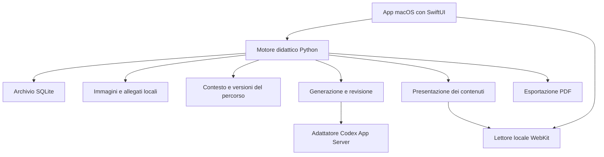

# Architettura di DidactyX per macOS

- **Data:** 18 novembre 2026; riallineamento documentale allo stato 0.3.3
- **Stato:** stack approvato; fondazione, progettazione annuale e primo traguardo dei contenuti implementati
- **Ambito:** prima applicazione locale per macOS
- **Riferimento di prodotto:** [Project Brief](PROJECT_BRIEF.md)
- **Evidenze precedenti alla scelta:** [verifica tecnica iniziale](TECHNICAL_FEASIBILITY.md)

## 1 Decisioni approvate

| Componente | Scelta | Responsabilità |
| --- | --- | --- |
| Applicazione macOS | Swift e SwiftUI | Finestre, home dei programmi, navigazione, brief, azioni e impostazioni. |
| Visualizzazione dei materiali | WebKit tramite WKWebView | Presentazione locale dei contenuti con impaginazione editoriale, formule, immagini e schemi. |
| Motore didattico | Python | Coordinamento del workflow, contesto, autori, revisori e controlli. |
| Archivio | SQLite e file locali | Programmi, versioni, materiali, attività e allegati. |
| Accesso generativo | Adattatore Codex App Server | Comunicazione con l'account e con le funzioni verificate nel laboratorio. |
| Esportazione | Componente separato, inizialmente ReportLab | Produzione dei PDF a partire dai materiali salvati. |

Il prodotto iniziale è rivolto a macOS. Windows rimane una possibilità futura: non si assume che l'interfaccia SwiftUI sia trasferibile direttamente. La separazione del motore e dei dati permette di conservarne la logica se verrà realizzata un'altra interfaccia.

Queste scelte definiscono lo stack. I dettagli di struttura, comunicazione e conservazione indicati di seguito costituiscono la base di implementazione e potranno essere affinati con i riscontri, mantenendo i requisiti del brief.

## 2 Struttura generale



Il motore è il punto che coordina il lavoro e aggiorna l'archivio. L'interfaccia invia richieste del docente e mostra risultati e avanzamento; non contiene una seconda implementazione delle regole didattiche o di versionamento.

Il lettore e l'esportatore utilizzano la stessa versione del contenuto strutturato. I due impaginatori possono avere regole editoriali differenti, ma non devono produrre spiegazioni, soluzioni o obiettivi diversi.

## 3 Applicazione macOS

SwiftUI gestisce i tre ambienti concordati: home dei programmi, spazio di lavoro del programma e impostazioni. Lo stile resta dark, minimale, con tipografia e comandi ispirati a un terminale grafico.

WKWebView viene usato per il materiale didattico nell'area centrale. Il contenuto viene composto da template e risorse locali, con una pagina chiara e leggibile. L'app non richiede un sito pubblicato o una pagina remota per mostrare le lezioni.

La barra delle richieste rende evidente l'ambito corrente. Lo scheletro è consultabile; le richieste di modifica passano al motore e seguono la rigenerazione completa, senza controlli di modifica manuale isolata delle UDA.

L'interfaccia deve rimanere utilizzabile durante la generazione. Mostra lo stato del lavoro con messaggi comprensibili e consente di consultare i risultati già disponibili.

## 4 Motore e comunicazione locale

Il motore Python funziona come processo locale avviato e gestito dall'app. La comunicazione usa messaggi JSON su standard input e output, con identificativi delle richieste e risposte; l’interfaccia legge l’avanzamento delle attività. Il pacchetto locale include Python e le dipendenze necessarie all’esecuzione.

Le operazioni esposte al programma riguardano azioni del prodotto: creare o aprire un programma, salvare un brief, generare o revisionare un materiale, richiedere una modifica, esportare e leggere lo stato dell'account. Il contratto è in `schemas/local-rpc.schema.json`.

Le operazioni lunghe vengono rappresentate come attività persistenti. La chiusura o interruzione di un'attività conserva i risultati completati e rende riconoscibile il punto raggiunto. La ripresa controlla le versioni del contesto prima di continuare.

Il coordinamento degli agenti è interno al motore. Autore e revisore hanno responsabilità e input distinti; una lezione può essere suddivisa tra più autori e deve poi ricevere una revisione del risultato ricomposto. Numero di esecuzioni, concorrenza e modelli saranno regolati in base alle necessità e alle capacità effettive, senza introdurre limiti arbitrari alla profondità didattica.

## 5 Archivio e contenuti

SQLite conserva le informazioni che devono rimanere coerenti tra loro: programmi, brief, scheletri, metadati, versioni dei contenuti, collegamenti, revisioni e stato delle attività. Le immagini e gli altri allegati voluminosi vengono conservati in cartelle locali e referenziati dall'archivio.

Il contenuto didattico ha una rappresentazione JSON strutturata e versionata, con blocchi riconoscibili per testo, formule, esempi, esercizi, mappe e immagini. Il formato viene validato prima di acquisire un risultato generato. Lo schema SQLite è alla versione 3, con migrazioni dalla fondazione e dalla progettazione annuale. Il contratto dei contenuti attualmente implementati è in `schemas/lesson-content.schema.json`; immagini, mappe ed esercizi strutturati saranno estesi nei rispettivi incrementi.

Il motore controlla la scrittura dell'archivio. Un materiale mantiene il riferimento alle versioni del programma, del contesto e delle fonti interne utilizzate. Le versioni precedenti vengono conservate; il completamento di una rigenerazione rende corrente la nuova struttura attraverso un aggiornamento coerente. Un risultato parziale non sostituisce la struttura annuale precedente.

Il brief modificato ma non ancora applicato rimane distinto dal contesto che ha prodotto lo scheletro corrente. Il database e gli allegati del docente sono dati operativi dell'app e rimangono separati dal repository del codice.

## 6 Memoria didattica

La memoria autorevole del programma appartiene a DidactyX. La cronologia delle conversazioni Codex è utile al lavoro generativo e alla sua ripresa, ma non sostituisce l'archivio del prodotto.

Il contesto di una generazione comprende obiettivi e prerequisiti, sezioni pertinenti del brief, posizione nel percorso, contenuti precedenti effettivi, esempi, terminologia, esercitazioni, mappe e feedback disponibili. Il motore deve poter recuperare i materiali originali oltre agli eventuali riepiloghi.

I collegamenti ai concetti rendono verificabile dove un argomento viene introdotto, esercitato e valutato. La generazione fuori sequenza distingue quanto è soltanto pianificato da quanto è già stato sviluppato. L'utilizzo in classe e l'apprendimento non vengono dedotti dalla sola presenza di un materiale.

Per le verifiche vengono recuperate lezioni, esercitazioni e mappe pertinenti, nelle versioni coerenti con la prova. Per il recupero si aggiungono la verifica di riferimento e il feedback del docente.

## 7 Adattatore Codex

La comunicazione con Codex è concentrata in un componente dedicato, separato dalla progettazione didattica. Il componente gestisce disponibilità del processo, compatibilità del protocollo, stato dell'account, richieste, streaming, risultati strutturati, immagini, interruzioni ed errori.

La prima integrazione parte dal meccanismo locale verificato con il login ChatGPT gestito da Codex App Server. La dipendenza dal CLI viene rilevata e verificata esplicitamente. La disponibilità delle funzioni non viene dedotta dalla sola presenza di una voce nel catalogo o nella configurazione.

La modalità di accesso di un nuovo docente e il confezionamento della dipendenza Codex richiedono una verifica dedicata. La documentazione e le prove hanno evidenziato differenze tra il login gestito attuale e la via Sign in with ChatGPT, in particolare per le immagini. Un'eventuale modifica dell'accesso deve preservare le capacità richieste o rendere esplicito ciò che cambia.

Le impostazioni mostrano l'account e i dati di utilizzo quando disponibili. La consultazione e l'esportazione dei materiali locali rimangono indipendenti da una nuova generazione AI.

## 8 Visualizzazione ed esportazione

Le mappe vengono conservate come concetti e relazioni; il renderer produce una rappresentazione leggibile. Le immagini raster sono allegati con riferimenti al contenuto e alla versione che le utilizza. Entrambe le forme ricevono i controlli didattici e visivi previsti.

ReportLab è la base iniziale dell'esportazione, già verificata su un campione con testo, formule semplici, grafica vettoriale e immagine raster. Prima di considerare definitivo il componente editoriale vanno provati formule complesse, mappe articolate, tabelle e raccolte lunghe. Un eventuale cambiamento del renderer non deve modificare il formato autorevole dei materiali o il motore generativo.

Ogni PDF corrisponde alla versione selezionata del materiale. L'export non avvia una rigenerazione del contenuto. Il programma annuale è esportabile dallo scheletro e include UDA, metadati e lezioni previste, escludendo le lezioni aggiuntive di recupero.

## 9 Organizzazione iniziale del repository

La struttura di lavoro proposta è:

```text
macos/        Applicazione SwiftUI e collegamento al motore
engine/       Motore Python, archivio, contesto, workflow e renderer
schemas/      Contratti dei messaggi e dei contenuti
tests/        Verifiche del comportamento e delle integrazioni
docs/         Requisiti, architettura, piano ed evidenze
experiments/  Prove separate dall'implementazione del prodotto
```

Le cartelle applicative sono presenti per gli incrementi implementati. I prototipi esistenti rimangono in `experiments/` e costituiscono evidenze e riferimenti, senza essere promossi automaticamente a motore definitivo.

## 10 Ordine di realizzazione

Il dettaglio dei risultati attesi è nel [piano di sviluppo](IMPLEMENTATION_PLAN.md). La sequenza proposta, coerente con le priorità del brief, è: fondazione locale, progettazione annuale completa, lezioni e qualità didattica, materiali collegati, recupero e consolidamento dell'app macOS.

Le verifiche del collegamento tra app e motore e della conservazione dei dati precedono l'utilizzo quotidiano. La validazione dei contenuti accompagna ogni fase generativa, insieme al confronto sui materiali reali con il docente.

## 11 Riferimenti tecnici

- [SwiftUI](https://developer.apple.com/swiftui/): framework scelto per l'interfaccia macOS.
- [WKWebView](https://developer.apple.com/documentation/webkit/wkwebview): presentazione di contenuti locali nell'app.
- [SQLite](https://www.sqlite.org/whentouse.html): archivio incorporato nell'applicazione.
- [Codex App Server](https://learn.chatgpt.com/docs/app-server): protocollo del collegamento verificato.
- [Limitazioni di Sign in with ChatGPT](https://developers.openai.com/siwc/token-sharing-open-source/preview-limitations): distinzione da mantenere nel progettare l'accesso.

## 12 Dettagli ancora da definire

Fondazione, progettazione annuale e contenuti delle lezioni hanno un protocollo locale JSON a righe, migrazioni SQLite fino alla versione 3, schemi del percorso e dei contenuti, attività persistenti con ripresa per passaggio e un runtime Python incluso nell'app. I contratti sono in `schemas/`; l'implementazione è descritta in [ANNUAL_PLANNING.md](ANNUAL_PLANNING.md) e [LESSON_CONTENT.md](LESSON_CONTENT.md).

Restano da definire i contratti dei materiali collegati e del recupero, il recupero del contesto su percorsi lunghi, la scelta dei modelli per i diversi ruoli, i template editoriali dei materiali futuri, la distribuzione ad altri docenti e i requisiti minimi verificati del sistema. Il pilota è stato scelto su delega del docente: informatica, seconda superiore fittizia, tre lezioni Python. Il [passaggio di sessione](SESSION_HANDOFF.md) raccoglie decisioni, prove e limiti, senza confondere il pilota con la validazione del prodotto completo.

## 13 Primo traguardo dei contenuti implementato

`LessonStore` conserva versioni, dipendenze e revisioni dei materiali. `LessonManager` coordina progetto esplicativo, uno o più autori, eventuale ricomposizione e revisioni disciplinare e della continuità. I contenuti precedenti vengono recuperati integralmente nelle versioni salvate. Pubblicazione del risultato e punto di ripresa sono atomici; i riferimenti diventati obsoleti producono segnalazioni, senza riscritture automatiche.

Lettore WebKit e ReportLab usano gli stessi blocchi canonici. I casi Python supportati vengono controllati in un processo separato con restrizioni e limiti di tempo; i casi non eseguiti rimangono riconoscibili. Fonti e trascrizioni sono conservate nella versione. Dettagli operativi e limiti in [LESSON_CONTENT.md](LESSON_CONTENT.md).
