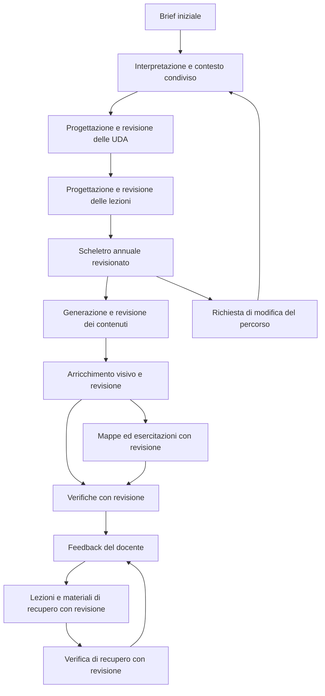

# DidactyX Project Brief

- **Versione:** 1.2
- **Data:** 15 novembre 2026
- **Stato:** requisiti e workflow concordati; stack macOS approvato, dettagli di implementazione in definizione
- **Prima piattaforma:** macOS
- **Destinatario iniziale:** il docente ideatore del progetto

DidactyX è un motore didattico che accompagna il docente dalla progettazione annuale alla produzione di materiali per l'apprendimento, la valutazione e il recupero. Il suo obiettivo prioritario è generare contenuti di qualità didattica molto elevata, capaci di costituire un'alternativa sostanziale e autosufficiente al libro di testo. Il raggiungimento di questo livello dovrà essere verificato su materiali completi e nel loro utilizzo didattico.

Il prodotto concentra la complessità nella generazione, nel coordinamento e nella revisione dei contenuti. L'esperienza del docente rimane minimale: descrivere le esigenze, consultare il percorso, richiedere materiali e modifiche, revisionare ed esportare PDF. Questo documento costituisce il riferimento di prodotto per l'implementazione.

Le precisazioni funzionali rendono verificabili i requisiti già espressi e ne chiariscono i casi ambigui. Lo stack approvato è documentato nell'[architettura macOS](ARCHITECTURE.md); gli aspetti ancora da decidere sono raccolti nella sezione 19 e i prossimi incrementi nel [piano di sviluppo](IMPLEMENTATION_PLAN.md).

## Indice

1. [Visione e obiettivi](#1-visione-e-obiettivi)
2. [Ambito e vincoli](#2-ambito-e-vincoli)
3. [Struttura del progetto didattico](#3-struttura-del-progetto-didattico)
4. [Brief e contesto condiviso](#4-brief-e-contesto-condiviso)
5. [Progettazione annuale](#5-progettazione-annuale)
6. [Continuità didattica delle lezioni](#6-continuità-didattica-delle-lezioni)
7. [Workflow generativo](#7-workflow-generativo)
8. [Ruoli degli agenti](#8-ruoli-degli-agenti)
9. [Materiali visivi e mappe](#9-materiali-visivi-e-mappe)
10. [Esercitazioni](#10-esercitazioni)
11. [Verifiche e varianti](#11-verifiche-e-varianti)
12. [Personalizzazione e accessibilità](#12-personalizzazione-e-accessibilità)
13. [Recupero dal feedback delle verifiche](#13-recupero-dal-feedback-delle-verifiche)
14. [Revisione e controllo del docente](#14-revisione-e-controllo-del-docente)
15. [Esportazione PDF](#15-esportazione-pdf)
16. [Interfaccia ed esperienza utente](#16-interfaccia-ed-esperienza-utente)
17. [Esecuzione locale e account](#17-esecuzione-locale-e-account)
18. [Criteri di qualità e scenari di accettazione](#18-criteri-di-qualità-e-scenari-di-accettazione)
19. [Decisioni aperte e gestione del documento](#19-decisioni-aperte-e-gestione-del-documento)

## 1 Visione e obiettivi

DidactyX eredita alcuni concetti di Schoolforge: generazione di lezioni, mappe, esercitazioni e verifiche. L'evoluzione principale è la progettazione didattica a monte e un workflow che mantiene la coerenza tra tutti i materiali prodotti.

Il percorso nasce dalla situazione reale della classe e dal traguardo che il docente intende raggiungere. La progettazione annuale suddivide il lavoro in unità di apprendimento, di seguito UDA, e lezioni. Da questa struttura si sviluppano i contenuti; dagli esiti delle verifiche possono nascere interventi di recupero che chiudono il ciclo didattico.

Le priorità, in ordine di rilevanza, sono:

1. Qualità, correttezza, profondità e utilità didattica dei contenuti.
2. Continuità del percorso e corrispondenza tra obiettivi, insegnamento, esercitazione e valutazione.
3. Rispetto delle indicazioni esplicite e dell'autonomia del docente.
4. Semplicità ed efficienza dell'interfaccia e delle operazioni.
5. Disponibilità locale dei progetti ed esportazione PDF affidabile.

La minimalità riguarda il software visibile al docente. La profondità delle spiegazioni e il lavoro interno necessario a produrle devono essere proporzionati all'esigenza didattica, senza limiti arbitrari di lunghezza o semplificazioni introdotte per comodità implementativa.

La completezza va valutata rispetto agli obiettivi e ai destinatari: un testo più lungo non è automaticamente migliore. Sono necessari i passaggi che permettono di comprendere, applicare e collegare i concetti; ripetizioni e dettagli estranei non sostituiscono la profondità didattica.

## 2 Ambito e vincoli

### 2.1 Prima versione

La prima versione è destinata all'utilizzo personale del docente su macOS. Comprende la raccolta dei programmi annuali, la progettazione, la generazione e revisione dei materiali, il recupero, l'esportazione PDF e un piccolo pannello impostazioni per account e dati locali.

Il docente distribuisce autonomamente i PDF agli studenti usando i canali che già utilizza. La possibilità di fornire successivamente l'app ad altri docenti, ciascuno con il proprio account, rimane una direzione prevista.

### 2.2 Perimetro escluso

La prima versione non richiede un portale studenti, un registro elettronico, un sistema di gestione della scuola, una piattaforma pubblica o un'infrastruttura di hosting. Non è previsto uno sdoppiamento obbligatorio dei materiali in versione docente e versione studente. Le soluzioni degli esercizi restano un contenuto gestibile secondo le richieste del docente.

Windows è una possibilità successiva, da valutare dopo l'utilizzo della versione macOS. Non costituisce un requisito di consegna della prima versione.

### 2.3 Distinzioni operative

Il repository Git ospita il codice e la documentazione del prodotto. L'applicazione conserva sul computer i progetti didattici e i materiali generati. Il repository non è il contenitore operativo dei dati delle classi o delle credenziali; il loro inserimento non deve essere richiesto per utilizzare il prodotto.

L'app è locale; la generazione attraverso i servizi OpenAI richiede connettività e accesso a un account compatibile. Il formato interno dei materiali è una scelta tecnica aperta. L'esportazione PDF è invece un requisito definito.

## 3 Struttura del progetto didattico

Un programma annuale è il contenitore di lavoro associato a una classe e a una progettazione didattica. Contiene:

- Dati descrittivi del programma.
- Brief iniziale suddiviso in sezioni.
- Scheletro annuale e relative versioni.
- UDA e lezioni previste, con metadati e collegamenti.
- Contenuti delle lezioni e materiali collegati.
- Progetti di laboratorio e relative tappe.
- Verifiche, varianti e indicazioni di adattamento.
- Feedback del docente e cicli di recupero associati alle UDA.
- Osservazioni dei revisori e collegamenti tra le versioni dei materiali.

### 3.1 Dati descrittivi

Ogni programma dispone almeno di titolo, classe e descrizione. Questi dati identificano il progetto nella home e possono essere aggiornati senza alterare automaticamente la progettazione.

La modifica di un'etichetta descrittiva va distinta dalla modifica del contesto didattico. Se cambiano effettivamente la classe destinataria, le sue conoscenze iniziali, gli obiettivi o le ore disponibili, la modifica deve entrare nel brief e seguire il processo di rigenerazione dello scheletro.

### 3.2 Percorso previsto e recupero

Il programma distingue le lezioni previste nello scheletro annuale dalle lezioni aggiuntive di recupero. Entrambe appartengono al progetto, ma soltanto le prime compaiono nell'export del programma annuale. Le lezioni e gli altri materiali di recupero sono comunque esportabili in PDF.

### 3.3 Coerenza delle versioni

Ogni generazione mantiene il riferimento al programma, alla versione dello scheletro, al contesto applicato e alle versioni dei materiali utilizzati. Questi collegamenti servono a riprodurre il contesto del lavoro e a individuare ciò che deve essere ricontrollato dopo una modifica; non richiedono una schermata tecnica obbligatoria.

Un materiale può essere conservato anche quando deriva da una versione precedente, ma non deve essere presentato come automaticamente coerente con il percorso corrente. I PDF già esportati rimangono documenti della versione da cui sono stati prodotti.

## 4 Brief e contesto condiviso

### 4.1 Inserimento libero e strutturazione interna

Il docente può scrivere un testo libero, utilizzare campi guidati o combinare le due modalità. Non è tenuto a fornire informazioni in un ordine prestabilito. Il motore interpreta, riordina e organizza il contenuto in sezioni separatamente utilizzabili.

| Sezione | Informazioni previste |
| --- | --- |
| Contesto scolastico | Tipo di scuola, indirizzo, materia, classe, età degli studenti e contesto di insegnamento. |
| Profilo degli studenti | Descrizione umana del gruppo, interessi, motivazione, difficoltà, bisogni, tono e ritmo appropriati. |
| Conoscenze iniziali | Concetti, procedure, abilità e competenze già posseduti; punto di partenza del percorso. |
| Traguardi | Obiettivi concreti, conoscenze, abilità e competenze attese; punto di arrivo desiderato. |
| Argomenti | Concetti obbligatori, facoltativi ed eventuali priorità. |
| Organizzazione | Ore disponibili, distribuzione tra teoria e laboratorio, strumenti, risorse e progetti. |
| Preferenze del docente | Stile, profondità, approccio alle spiegazioni, attività e altre indicazioni generali. |

### 4.2 Autonomia proporzionata alle informazioni

Il docente può indicare anche soltanto da dove partire e dove arrivare. Il motore deve poter costruire il resto attraverso ipotesi ragionevoli, rendendole riconoscibili. Un brief più dettagliato offre più vincoli e indicazioni; un brief essenziale lascia maggiore autonomia.

La mancanza di dettagli non deve trasformarsi automaticamente in un questionario obbligatorio o impedire la generazione. Un chiarimento è riservato alle ambiguità che non consentono di individuare il compito; negli altri casi il motore procede e permette di correggere successivamente il brief.

### 4.3 Brief specifici facoltativi

Lezioni, esercitazioni, mappe, immagini e verifiche possono ricevere un proprio brief facoltativo. Il contesto iniziale della classe accompagna sempre la generazione, anche in assenza di indicazioni specifiche.

Ogni agente usa le sezioni pertinenti al proprio compito e può recuperare le altre quando necessario. La suddivisione del brief rende possibile utilizzare alcune sezioni o tutte, senza perdere informazioni essenziali per gli obiettivi, gli studenti o il contenuto corrente. I dettagli dell'eventuale selezione manuale del contesto rimangono da progettare.

### 4.4 Rispetto delle indicazioni

Le richieste esplicite del docente prevalgono sulle impostazioni didattiche predefinite. Il contesto della classe rimane disponibile e consente al revisore di evidenziare eventuali scostamenti.

Per esempio, se il docente chiede tre esercizi molto difficili e senza spiegazioni, il motore produce esattamente tre esercizi con queste caratteristiche. Il revisore può segnalarne la distanza dal livello della lezione e proporre un adattamento; non deve aumentare il numero degli esercizi, aggiungere spiegazioni o ridurre la difficoltà di propria iniziativa.

Un brief specifico non modifica implicitamente gli obiettivi dell'intero anno. Quando una richiesta incide sulla progettazione annuale, si applica la rigenerazione completa prevista nella sezione 5.

Quando due indicazioni esplicite sono incompatibili, il motore segnala il conflitto invece di ignorarne una. Chiede una precisazione soltanto se il conflitto impedisce di ottenere un risultato utilizzabile; altrimenti rende riconoscibile l'interpretazione adottata e l'eventuale vincolo non soddisfatto.

### 4.5 Brief salvato e contesto applicato

Salvare una modifica al brief non equivale a rigenerare il percorso. Fino al comando **Rigenera scheletro**, il programma conserva la struttura corrente e il contesto da cui deriva, distinguendoli dalle nuove indicazioni ancora da applicare.

Le generazioni collegate al percorso corrente devono usare un contesto coerente, senza mescolare silenziosamente il nuovo brief con una pianificazione precedente. Una richiesta specifica relativa al solo materiale può essere applicata nel suo brief dedicato, senza farla diventare un cambiamento implicito dell'intero programma.

## 5 Progettazione annuale

### 5.1 Scheletro prima dei contenuti

La prima generazione produce la struttura annuale delle UDA e delle lezioni con i relativi metadati, senza sviluppare i contenuti completi. Lo scheletro deve essere consultabile e sufficientemente dettagliato da valutare l'intero percorso.

Per ogni UDA sono previsti titolo, finalità, obiettivi, conoscenze, abilità, competenze, concetti da affrontare, prerequisiti, durata e collocazione nel percorso, attività e modalità di valutazione. I riferimenti curricolari e l'eventuale schema richiesto dalla scuola devono essere riconducibili ai documenti pertinenti; non va presunto un unico modello ministeriale valido per ogni contesto.

Per ogni lezione sono previsti almeno titolo, collocazione nell'UDA e nel percorso annuale, durata, obiettivi, concetti, prerequisiti, tipologia teorica o laboratoriale e collegamenti ad attività o progetti. Lo schema definitivo dei metadati sarà precisato nella progettazione tecnica mantenendo queste esigenze.

### 5.2 Pianificazione realistica

Il monte ore comprende teoria, laboratorio, esercitazioni, verifiche, recupero e un margine per gli imprevisti. Il motore deve distinguere le ore dichiarate dal docente da quelle ipotizzate e controllare la compatibilità delle attività con il tempo disponibile.

La revisione deve verificare copertura degli obiettivi, corretto ordine dei prerequisiti, progressione, carico e distribuzione temporale. I controlli numerici, come la somma delle ore, affiancano la revisione didattica.

Il conteggio deve evitare di sommare due volte lo stesso intervallo quando un'attività integra più dimensioni, per esempio un progetto che applica teoria durante le ore di laboratorio. Le durate ipotizzate devono essere compatibili con il lavoro effettivamente richiesto agli studenti.

### 5.3 Teoria e laboratorio

Lezioni teoriche e attività laboratoriali vengono progettate insieme. Le competenze introdotte nella teoria devono poter essere applicate e consolidate nella pratica.

Un progetto può attraversare più UDA e svilupparsi durante l'anno. Deve avere tappe, prerequisiti, risultati attesi e collegamenti alle lezioni che forniscono gli strumenti per realizzarlo. Sono possibili attività progressive che confluiscono in un prodotto o progetto conclusivo.

### 5.4 Modifiche e rigenerazione completa

Il docente non modifica manualmente UDA o lezioni nello scheletro. Per cambiare la struttura aggiorna il brief oppure formula una richiesta di modifica. Il sistema incorpora la richiesta, rigenera l'intero scheletro annuale e ripete i controlli.

Questa regola protegge i collegamenti tra prerequisiti, obiettivi, ore, attività e valutazione: una modifica apparentemente locale può influenzare il resto del percorso.

La versione precedente viene conservata. Se esistono già contenuti, il sistema identifica quelli da riallineare e mantiene riconoscibile la struttura da cui derivano. La rigenerazione non deve far passare automaticamente i vecchi materiali per coerenti con il nuovo piano.

La nuova struttura diventa corrente dopo che la generazione e la revisione previste sono terminate. Un'interruzione non deve sostituire lo scheletro precedente con un risultato incompleto. Il collegamento dei vecchi materiali alle nuove lezioni richiede una verifica di corrispondenza didattica, anche quando i titoli sono simili.

## 6 Continuità didattica delle lezioni

La lezione non può dipendere soltanto dall'UDA corrente o dai metadati delle altre lezioni. Deve conoscere il percorso effettivo e poter recuperare i contenuti già sviluppati.

Il contesto didattico include concetti spiegati, esempi utilizzati, terminologia, notazione, procedure, esercitazioni, rappresentazioni visive e stato dei progetti. Il motore può mantenere una memoria organizzata di queste informazioni, conservando la possibilità di consultare i materiali originali.

I richiami devono essere concreti e verificabili. Una lezione può riprendere un procedimento precedente e applicarlo a un nuovo problema soltanto se quel procedimento è stato effettivamente introdotto, oppure se viene spiegato adeguatamente nella lezione corrente.

Il sistema distingue:

- **Pianificato:** presente nello scheletro, ma non ancora sviluppato.
- **Generato:** disponibile come materiale, senza presumere che sia già stato utilizzato in classe.
- **Spiegato ed esercitato:** affrontato secondo le informazioni del docente.
- **Appreso o ancora da consolidare:** valutabile attraverso feedback e riscontri del docente, senza dedurlo dalla sola presenza dei materiali.

Queste distinzioni guidano la generazione; non richiedono un registro elettronico o un sistema obbligatorio di tracciamento degli studenti.

Il docente può sviluppare le lezioni anche fuori sequenza. Il motore distingue allora i prerequisiti previsti da quelli già presenti nei materiali, evitando richiami a spiegazioni inesistenti. Quando vengono sviluppate le lezioni precedenti, deve poter verificare e riallineare i riferimenti delle successive.

## 7 Workflow generativo

Il workflow descrive responsabilità logiche e risultati. Non impone un numero fisso di processi o agenti contemporanei.

Il diagramma rappresenta le dipendenze principali. Mappe ed esercitazioni sono generazioni attivabili secondo necessità: se esistono, la verifica deve utilizzarle; la loro assenza non impedisce di generare una prova dai materiali disponibili. Il PDF è disponibile per lo scheletro e per i materiali prodotti nelle rispettive fasi.

### 7.1 Interpretazione

Un agente organizza il brief, distingue indicazioni e ipotesi e prepara il contesto comune.

### 7.2 Progettazione delle UDA

Un agente costruisce la struttura delle UDA considerando l'intero anno. Un revisore controlla obiettivi, prerequisiti, tempi, teoria, laboratorio e progetti e restituisce la struttura revisionata.

### 7.3 Progettazione delle lezioni

Un agente sviluppa lo scheletro delle lezioni di ogni UDA tenendo conto di tutte le UDA annuali. Un revisore controlla la sequenza e una revisione complessiva verifica il percorso assemblato. Il docente può consultarlo, esportarlo o richiederne la rigenerazione.

### 7.4 Sviluppo dei contenuti

Il docente seleziona una lezione, più lezioni o un'UDA e può fornire un brief specifico. Il coordinamento recupera il contesto pertinente e assegna il lavoro a uno o più autori. Il risultato viene ricomposto in una lezione coerente e sottoposto a revisione disciplinare e didattica.

### 7.5 Arricchimento e materiali collegati

Un ruolo dedicato propone e applica l'arricchimento visivo, seguito dal relativo revisore. Mappe ed esercitazioni hanno generazione e revisione dedicate. Il materiale finale deve restare coerente anche dopo l'inserimento di elementi visivi o l'applicazione di correzioni.

### 7.6 Valutazione

La generazione della verifica integra obiettivi, lezioni, esercitazioni, mappe e brief specifico. Il revisore verifica corrispondenza con la preparazione, correttezza, risolvibilità, tempi, adattamenti ed equivalenza delle varianti.

### 7.7 Recupero

Il feedback del docente viene interpretato per individuare gli obiettivi e i prerequisiti da recuperare. Si producono e revisionano lezioni aggiuntive e materiali mirati. La verifica di recupero utilizza anche questi nuovi materiali e il suo esito può avviare un ulteriore ciclo.

### 7.8 Regole comuni a ogni generazione

Ogni operazione definisce l'ambito selezionato, raccoglie il contesto pertinente e le sue versioni, interpreta il brief specifico, genera il risultato e lo sottopone al revisore competente. Le correzioni vengono ricontrollate prima di presentare il materiale come revisionato.

Se intervengono più autori, la revisione comprende il contenuto ricomposto. Le modifiche applicate dopo una revisione, incluse quelle visive che cambiano il significato, devono riattivare i controlli interessati. Il testo o le immagini di una versione precedente non costituiscono una verifica della nuova versione.

Un errore tecnico o un controllo non concluso deve risultare distinto da un'osservazione didattica. Il lavoro già completato viene conservato e il materiale incompleto rimane riconoscibile; non si dichiara conclusa una revisione che non è stata eseguita.

## 8 Ruoli degli agenti

| Ruolo logico | Responsabilità |
| --- | --- |
| Interprete del brief | Riordinare le informazioni e preparare il contesto condiviso. |
| Progettista delle UDA | Costruire la struttura annuale e integrare teoria, laboratorio e progetti. |
| Revisore della progettazione | Controllare obiettivi, prerequisiti, tempi e coerenza complessiva. |
| Progettista delle lezioni | Definire le lezioni di ogni UDA nel contesto dell'intero anno. |
| Revisore delle lezioni pianificate | Verificare progressione, carico e copertura dello scheletro. |
| Coordinatore dei contenuti | Preparare il contesto, distribuire il lavoro e ricomporre contributi coerenti. |
| Autore delle lezioni | Sviluppare spiegazioni, esempi e attività con la profondità necessaria. |
| Revisore dei contenuti | Controllare correttezza disciplinare, completezza e qualità didattica. |
| Autore visivo e revisore visivo | Individuare, produrre, applicare e verificare immagini e schemi. |
| Autore e revisore delle mappe | Costruire e verificare concetti, relazioni e rappresentazione. |
| Autore e revisore delle esercitazioni | Costruire e verificare esercizi, gradualità, aiuti e soluzioni. |
| Autore e revisore delle verifiche | Produrre e controllare prove, varianti e adattamenti. |
| Analista del feedback | Collegare gli esiti descritti dal docente a difficoltà e obiettivi da recuperare. |

Questi ruoli possono essere implementati con agenti distinti o con esecuzioni specializzate. Una lezione complessa può richiedere più autori, con una regia comune e una revisione dell'intero risultato. Più agenti non costituiscono di per sé una garanzia di qualità: il coordinamento deve evitare ripetizioni, omissioni e contraddizioni.

## 9 Materiali visivi e mappe

### 9.1 Arricchimento delle lezioni

L'agente visivo legge il contenuto e individua i punti in cui immagini, diagrammi, schemi o esempi illustrati migliorano la comprensione. Propone gli interventi e li applica nel materiale secondo il brief eventualmente fornito.

Le rappresentazioni seguono uno stile riconoscibile e coerente. Il controllo riguarda utilità didattica, correttezza, etichette, leggibilità, rapporto con il testo e resa nel PDF. La produzione visiva può impiegare tecniche diverse in funzione del contenuto; gli strumenti saranno scelti durante l'implementazione.

Lo stile comune riguarda l'insieme dei materiali del programma e deve permettere di distinguere testo, etichette e relazioni anche in stampa. Il revisore verifica che le informazioni affidate a un'immagine siano spiegate o richiamate adeguatamente nel materiale. Le richieste visive esplicite vengono rispettate; le aggiunte autonome devono avere una funzione didattica riconoscibile.

### 9.2 Mappe concettuali

Le mappe sono materiali didattici specifici: contengono concetti e relazioni esplicite e verificabili. Vengono generate dalle lezioni e dagli obiettivi, considerando gli studenti e il brief dedicato.

Il revisore controlla che la mappa rappresenti correttamente il contenuto, mantenga le relazioni essenziali e sia leggibile. Sono previste mappe adattate alle esigenze degli studenti, inclusi DSA e studenti con disabilità, evitando di applicare automaticamente un'unica soluzione a profili differenti.

## 10 Esercitazioni

La modalità predefinita costruisce una progressione: esempi completamente svolti, esercizi guidati con aiuti progressivamente ridotti e attività autonome con soluzioni disponibili secondo la richiesta del docente.

La generazione considera lezioni, mappe disponibili, obiettivi, competenze iniziali e contenuti già incontrati. Può includere applicazioni teoriche, attività di laboratorio e avanzamenti dei progetti annuali.

Il docente può specificare numero, difficoltà, formato, quantità di spiegazioni, presenza e collocazione delle soluzioni e altri vincoli. Le richieste prevalgono sulla progressione predefinita.

Il revisore controlla comprensibilità delle consegne, dati sufficienti, risolvibilità, correttezza delle soluzioni, eventuali risposte alternative e adeguatezza della difficoltà. Un tentativo di risoluzione indipendente aiuta a verificare esercizi e soluzioni. Gli scostamenti didattici intenzionali vengono segnalati e mantenuti finché il docente non richiede un adattamento.

## 11 Verifiche e varianti

### 11.1 Fonti obbligatorie quando disponibili

La verifica deve integrare:

1. Obiettivi e competenze da valutare.
2. Lezioni effettivamente sviluppate e informazioni su quanto affrontato in classe.
3. Esercitazioni proposte, procedure utilizzate, difficoltà e aiuti forniti.
4. Mappe disponibili, con i concetti e le relazioni evidenziati per lo studio.
5. Profilo della classe e brief specifico della prova.

Mappe ed esercitazioni disponibili vengono recuperate automaticamente. Non sono semplici riferimenti opzionali ignorabili dal generatore. Se mancano, la prova può essere generata dalle fonti esistenti senza presumere esercizi o attività mai proposti.

Il recupero riguarda i materiali pertinenti all'ambito della prova e le loro versioni coerenti. La presenza nel progetto di mappe o esercizi su altri argomenti non ne impone l'inclusione nella verifica. I collegamenti tra quesiti, obiettivi e preparazione devono essere ricostruibili per consentire la revisione.

### 11.2 Mini brief della prova

Il docente può indicare ambito, obiettivi, durata, numero di quesiti, tipologie, difficoltà, varianti e adattamenti. La prova può riguardare una lezione, più lezioni o l'UDA pertinente. In assenza di un brief specifico, il motore usa il contesto e propone una prova coerente.

Di norma i quesiti verificano l'uso delle conoscenze e delle procedure esercitate attraverso consegne equivalenti o nuove applicazioni, evitando che la sola riproduzione di un esercizio noto sia scambiata per comprensione. Il docente può comunque richiedere esplicitamente il riutilizzo delle stesse consegne.

### 11.3 N varianti

È possibile richiedere N prove attraverso riordinamento di domande e opzioni oppure variazioni di dati, esempi e formulazioni che valutino gli stessi concetti. Il numero delle varianti non è prefissato dal prodotto.

Il revisore verifica che le varianti richiedano competenze equivalenti e abbiano difficoltà, carico e tempi comparabili. Una piccola variazione dei dati può cambiare sensibilmente la difficoltà: l'equivalenza va controllata sul contenuto.

La variante mantiene il collegamento corretto tra consegne, eventuali soluzioni e criteri di valutazione anche dopo il riordinamento. L'equivalenza viene verificata tra prove con gli stessi obiettivi e adattamenti. Una prova su obiettivi personalizzati non deve essere forzata ad avere la stessa difficoltà di una prova con obiettivi differenti.

### 11.4 Revisione della prova

La revisione controlla correttezza, ambiguità, soluzioni, copertura degli obiettivi, tempi e corrispondenza tra preparazione e richieste. Rileva argomenti mai spiegati, procedure mai esercitate e salti di difficoltà. Quando questi scostamenti sono esplicitamente richiesti dal docente, li segnala senza annullare la richiesta.

Non è previsto uno sdoppiamento obbligatorio tra prova per il docente e prova per lo studente. L'organizzazione di eventuali soluzioni e criteri di valutazione deve rimanere semplice e coerente con il materiale richiesto.

## 12 Personalizzazione e accessibilità

Il mini brief deve consentire di richiedere prove sugli obiettivi minimi, obiettivi personalizzati per studenti con disabilità e adattamenti per studenti DSA, senza costringere il docente a ripetere tutte le informazioni presenti nel progetto.

Le dimensioni gestibili includono formulazione linguistica, presentazione, supporti, quantità di lavoro, tempi previsti, domande facoltative e obiettivi da valutare. La personalizzazione riguarda anche lezioni, immagini, mappe ed esercitazioni.

L'accessibilità del materiale e la modifica degli obiettivi sono aspetti distinti. Allo stesso modo, concedere più tempo e rendere facoltativi alcuni quesiti sono interventi diversi, richiedibili insieme o separatamente. Il motore segue le indicazioni del docente e non deduce un adattamento uniforme dalla sola etichetta DSA o disabilità.

La revisione deve verificare che gli adattamenti richiesti siano effettivamente presenti e che il contenuto rimanga coerente con gli obiettivi dichiarati per quella prova o quel materiale.

## 13 Recupero dal feedback delle verifiche

### 13.1 Attivazione

Da una verifica o dall'UDA, il docente seleziona **Genera recupero** e descrive cosa è accaduto: concetti non compresi, errori ricorrenti, difficoltà applicative, ritmo insufficiente o altre osservazioni. Può aggiungere indicazioni sul nuovo approccio, sul numero di lezioni o sul tempo disponibile.

Il motore recupera automaticamente contesto, obiettivi, lezioni, mappe, esercitazioni e prova di riferimento. Non richiede la compilazione di un sistema di analisi dei voti.

### 13.2 Interpretazione del feedback

L'analisi collega le difficoltà a concetti, prerequisiti e obiettivi. Distingue ciò che il docente ha osservato dalle possibili cause: un errore applicativo può dipendere da comprensione del testo, scelta della procedura o conoscenza del concetto.

Un feedback essenziale consente comunque di procedere con ipotesi esplicite. Non si devono inventare esiti, difficoltà o progressi non descritti.

### 13.3 Generazione del recupero

Il sistema genera una o più lezioni aggiuntive collegate all'UDA. Può usare esempi concreti, passaggi più piccoli, ritmo più lento, rappresentazioni diverse, errori commentati e applicazioni guidate.

Il recupero deve cercare una strada esplicativa diversa quando necessario; la sola parafrasi della lezione precedente non soddisfa l'obiettivo. Può produrre anche mappe, immagini ed esercitazioni mirate con revisione dedicata.

### 13.4 Verifica e nuovo ciclo

La verifica di recupero considera gli obiettivi interessati e tutti i nuovi materiali disponibili, comprese esercitazioni e mappe. Il feedback successivo può avviare ulteriori interventi.

Le lezioni di recupero restano separate dalle lezioni previste nel programma annuale e non entrano nel suo export. Sono consultabili accanto all'UDA ed esportabili come materiali PDF. Le informazioni emerse possono orientare anche le lezioni successive, mantenendo distinta la modifica dei contenuti da un'eventuale modifica della struttura annuale.

### 13.5 Tempi e collegamento al percorso

L'esclusione dall'export del programma non rende illimitato il tempo disponibile per il recupero. Il motore considera le ore già riservate a questo scopo o il tempo aggiuntivo indicato dal docente. Se il recupero richiede una diversa distribuzione delle lezioni previste, segnala la necessità di modificare il percorso tramite rigenerazione completa, senza riscriverlo implicitamente.

## 14 Revisione e controllo del docente

### 14.1 Revisione automatica e su richiesta

Ogni fase generativa prevede una revisione specializzata. Inoltre, ogni contenuto dispone del comando **Revisiona**, che ricontrolla quel livello considerando il suo contesto e i collegamenti rilevanti.

Il risultato deve presentare osservazioni concrete e permettere al docente di mantenere il materiale, applicare gli aggiustamenti proposti o dare ulteriori indicazioni al revisore. La segnalazione di uno scostamento didattico non costituisce un blocco obbligatorio.

### 14.2 Correttezza e scelta didattica

Il revisore distingue errori oggettivi, problemi di chiarezza, omissioni e scelte didattiche intenzionali. Una soluzione errata e un esercizio deliberatamente molto difficile richiedono valutazioni diverse.

Il workflow può includere correzione e ricontrollo interni per arrivare a un risultato corretto. Queste operazioni non devono annullare richieste esplicite su difficoltà, numero degli esercizi, assenza di spiegazioni o altri aspetti intenzionali. Gli aggiustamenti successivi richiesti tramite il revisore restano sotto il controllo del docente.

Per lo scheletro annuale, una proposta di modifica deve sempre passare dalla rigenerazione dell'intera struttura. Il comando di revisione non introduce una modifica manuale isolata delle UDA.

### 14.3 Esito della revisione

Le osservazioni devono indicare il punto interessato, il problema rilevato, la sua conseguenza e l'eventuale correzione proposta. Vanno distinti gli errori di contenuto, i problemi di coerenza con il percorso, le raccomandazioni didattiche e i controlli non completati.

Le correzioni automatiche previste dal workflow sono ricontrollate; il docente può mantenere le proprie scelte didattiche anche in presenza di raccomandazioni differenti. Se restano errori o controlli irrisolti, il materiale non deve essere descritto come privo di problemi. Il giudizio del revisore rimane riferito alla versione effettivamente esaminata.

### 14.4 Versioni e riallineamento

Il sistema conserva le versioni precedenti e rende riconoscibili i legami tra piano, lezioni e materiali. Se cambia un contenuto, identifica mappe, esercizi, immagini e verifiche potenzialmente interessati. I risultati precedenti non vengono considerati automaticamente riallineati.

Il livello di dettaglio visibile nell'interfaccia va mantenuto essenziale. La tracciabilità è principalmente una responsabilità interna del motore.

Il riallineamento può avvenire attraverso revisione, correzione o rigenerazione dei materiali interessati, conservando i precedenti. La modifica di una lezione non deve avviare una riscrittura incontrollata dell'intero archivio; il motore deve identificare le dipendenze effettive e gli interventi necessari. La rigenerazione dello scheletro rimane invece sempre completa.

## 15 Esportazione PDF

### 15.1 Materiali

Sono esportabili lezioni, immagini e schemi inseriti nei materiali, mappe concettuali, esercitazioni, verifiche, varianti e materiali di recupero. Deve essere possibile esportare anche raccolte coerenti di materiali, per esempio quelli di un'UDA.

L'export deve preservare formule, grafica, gerarchia del testo e leggibilità. Il controllo finale comprende impaginazione, dimensioni, interruzioni di pagina e assenza di elementi tagliati o sovrapposti.

L'esportazione deve corrispondere al materiale selezionato e non rigenerarne silenziosamente il contenuto. L'inclusione delle soluzioni segue la richiesta del docente: può essere gestita nello stesso materiale o nell'esportazione, senza introdurre due versioni obbligatorie per ruoli diversi. Le opzioni editoriali di dettaglio saranno definite con i template PDF.

### 15.2 Programma annuale completo

L'export del programma è disponibile già dopo la generazione dello scheletro e non richiede lo sviluppo delle lezioni. Comprende:

- Identificazione del programma e della classe.
- UDA nell'ordine del percorso, ciascuna con titolo e metadati.
- Lezioni previste all'interno di ciascuna UDA, con titolo e relativi metadati.

Le lezioni aggiuntive di recupero sono escluse. Il documento deve riflettere la versione dello scheletro selezionata e non mescolare versioni diverse.

### 15.3 Leggibilità editoriale

Il PDF è un prodotto didattico destinato alla lettura e all'eventuale stampa. Adotta un linguaggio visivo chiaro, semplice e leggibile. L'estetica dark e futuristica dell'app non deve trasferire oscurità, decorazioni o caratteri da terminale nei materiali.

## 16 Interfaccia ed esperienza utente

### 16.1 Principio generale

L'interfaccia è ultraminimale, efficiente e curata, con uno stile da terminale grafico futuristico in dark mode. Il docente interagisce attraverso richieste in linguaggio naturale e azioni riconoscibili; non è richiesta sintassi da linea di comando.

La complessità degli agenti non deve emergere come un pannello di orchestrazione obbligatorio. L'esperienza principale comprende tre soli ambienti: home dei programmi, spazio di lavoro del programma e piccolo pannello impostazioni.

### 16.2 Home

La schermata iniziale mostra tutti i programmi annuali creati. Una griglia di schede essenziali presenta titolo, classe e descrizione. Un pulsante principale consente di creare un **Nuovo programma**.

Il clic su una scheda apre direttamente il programma. Un comando discreto consente di tornare a **Tutti i programmi**. La home non richiede statistiche, grafici o una dashboard gestionale.

### 16.3 Creazione del programma

Dati descrittivi e brief vengono raccolti in un unico ambiente, evitando un percorso di configurazione inutilmente lungo. Il comando principale è **Genera percorso annuale**. Il progetto viene salvato anche quando il lavoro è ancora incompleto.

### 16.4 Spazio di lavoro

La struttura concordata comprende:

- Colonna laterale richiudibile con UDA, lezioni, materiali e recuperi associati.
- Ampia area centrale per consultare lo scheletro o leggere il materiale selezionato.
- Barra contestuale per il brief o la richiesta relativa all'elemento corrente.

Le azioni compaiono nel contesto appropriato: **Genera**, **Rigenera scheletro**, **Revisiona**, **Genera recupero** ed **Esporta PDF**. Le opzioni meno frequenti sono raccolte in pannelli richiudibili.

La barra rende sempre riconoscibile il destinatario della richiesta, per esempio l'intero programma, una lezione o una verifica. Lo scheletro viene presentato come consultabile, con una via evidente per richiederne la modifica, evitando controlli che facciano pensare alla modifica manuale diretta delle UDA.

### 16.5 Linguaggio visivo

La direzione concordata prevede fondo grafite quasi nero, pannelli discreti, bordi sottili, testo chiaro, accento ciano e animazioni brevi. I caratteri monospaziati sono adatti a comandi, percorsi e stati; il materiale usa tipografia editoriale e una pagina chiara vicina al PDF finale.

L'effetto futuristico deriva da tipografia, precisione degli allineamenti, spazio e risposte dell'interfaccia. I colori esatti, le dimensioni e il sistema di componenti saranno definiti in fase di design.

### 16.6 Stato del lavoro

Durante la generazione l'app comunica attività comprensibili, per esempio «Controllo i prerequisiti delle lezioni». I dettagli tecnici possono essere espandibili, senza occupare l'esperienza principale. Il salvataggio automatico e la ripresa del lavoro riducono le operazioni richieste al docente.

### 16.7 Impostazioni

Una piccola finestra accessibile dalla home raccoglie:

| Sezione | Funzioni |
| --- | --- |
| Account Codex | Collegamento attraverso il flusso ufficiale, account collegato, stato della connessione, cambio account e disconnessione. |
| Informazioni di utilizzo | Quota e limiti soltanto quando disponibili attraverso l'integrazione. |
| Dati locali | Cartella dei progetti, destinazione predefinita dei PDF e apertura delle cartelle nel Finder. |

Eventuali impostazioni avanzate vengono aggiunte soltanto quando necessarie. Al primo avvio, in assenza del collegamento richiesto per generare, l'app presenta **Collega il tuo account**. Una volta configurata, l'apertura conduce alla raccolta dei programmi.

Il collegamento all'account riguarda le funzioni di generazione. La consultazione e l'esportazione dei materiali già disponibili localmente non devono richiedere una nuova generazione o un accesso continuo al servizio.

## 17 Esecuzione locale e account

L'obiettivo è usare il proprio account ChatGPT con accesso a Codex e la relativa disponibilità di utilizzo attraverso un'integrazione ufficiale compatibile con un'app locale. La modalità esatta, le funzionalità consentite, l'accesso ai modelli e la disponibilità delle informazioni sulla quota dovranno essere verificati nell'implementazione.

Non viene assunto che l'abbonamento renda disponibile qualsiasi API o strumento, né che l'esecuzione locale elimini i limiti del servizio. Le capacità di generazione visiva dovranno essere verificate separatamente rispetto a quelle testuali.

L'esperienza desiderata evita la necessità di gestire hosting e chiavi API per l'utilizzo iniziale. Non sono stati scelti servizi alternativi a pagamento, credenziali o modelli specifici.

Il sistema deve salvare il lavoro e poter riprendere una generazione interrotta. Un limite di quota non deve causare la perdita dei risultati già prodotti o una riduzione silenziosa della qualità e della completezza richieste.

La ripresa utilizza un contesto coerente con quello del lavoro interrotto. Se nel frattempo sono cambiati piano o materiali di riferimento, il sistema identifica la differenza prima di continuare, evitando di assemblare contributi appartenenti a versioni incompatibili. Le capacità non disponibili attraverso l'account collegato devono risultare esplicite, senza sostituzioni automatiche con servizi a pagamento o con materiali di qualità inferiore.

In prospettiva, ogni docente che riceverà l'app userà il proprio account e conserverà i propri progetti. Le modalità di distribuzione saranno definite dopo la prima versione per macOS.

## 18 Criteri di qualità e scenari di accettazione

### 18.1 Qualità dei materiali

La qualità deve essere valutata su contenuti reali, non sul solo completamento della generazione. Una prima validazione significativa richiede almeno un'UDA sviluppata con lezioni, materiali visivi pertinenti, mappe, esercitazioni, verifica e un esempio di recupero.

I controlli devono considerare correttezza disciplinare, autosufficienza delle spiegazioni, introduzione dei termini, assenza di salti logici, qualità degli esempi, progressione degli esercizi, correttezza delle soluzioni, utilità delle immagini, continuità tra le lezioni e coerenza della valutazione.

La scelta delle fonti disciplinari, la loro verifica e le regole per usarle nei contenuti costituiscono un lavoro da definire prima di dichiarare raggiunto il livello qualitativo desiderato. La revisione automatica contribuisce al controllo ma non rappresenta da sola una prova di qualità.

Per ogni obiettivo deve essere possibile verificare dove viene introdotto, spiegato, esercitato e valutato, quando previsto. Il recupero deve rendere riconoscibile quale difficoltà affronta e con quale cambiamento di approccio. Questi collegamenti sono un criterio di qualità del motore e non implicano una matrice obbligatoria da compilare manualmente.

Riferimenti curricolari, citazioni e attribuzioni eventualmente presenti nei materiali devono essere verificabili. Il generatore deve distinguere un riferimento effettivamente consultato da una propria ipotesi e non attribuire una fonte o una prescrizione ministeriale senza riscontro.

### 18.2 Scenari funzionali di riferimento

| Scenario | Comportamento atteso |
| --- | --- |
| Brief essenziale | Indicando punto di partenza e traguardo, il docente ottiene uno scheletro con ipotesi riconoscibili. |
| Brief aggiornato | Una richiesta di modifica rigenera tutto lo scheletro e conserva la versione precedente. |
| Brief salvato senza rigenerazione | Le nuove indicazioni restano distinguibili dal contesto applicato al percorso corrente. |
| Progetto annuale di laboratorio | Le attività possono attraversare più UDA con tappe e prerequisiti coerenti. |
| Lezione successiva | I richiami recuperano contenuti realmente sviluppati e non si basano soltanto sui titoli. |
| Lezione generata fuori sequenza | Il materiale non rimanda a spiegazioni inesistenti e può essere ricontrollato quando i prerequisiti vengono sviluppati. |
| Esercitazione intenzionalmente difficile | La richiesta di tre esercizi difficili senza spiegazioni viene rispettata; le osservazioni del revisore restano consultive. |
| Verifica con materiali disponibili | Lezioni, esercitazioni e mappe vengono utilizzate automaticamente insieme agli obiettivi e al brief. |
| Materiali appartenenti a versioni diverse | La generazione identifica i riferimenti da riallineare prima di considerarli coerenti. |
| N varianti | Le prove valutano gli stessi concetti con difficoltà, tempi e carico comparabili. |
| Varianti e adattamenti combinati | L'equivalenza viene valutata tra prove con gli stessi obiettivi e adattamenti; soluzioni e quesiti restano correttamente associati. |
| Adattamento della verifica | Obiettivi minimi o personalizzati e altri adattamenti richiesti vengono applicati senza ripetere tutto il contesto. |
| Recupero | Il feedback produce lezioni aggiuntive mirate e materiali utili alla verifica di recupero. |
| Recupero oltre il tempo disponibile | Il sistema esplicita il problema e non modifica implicitamente la distribuzione annuale. |
| Export del programma | Il PDF include UDA e lezioni previste con metadati, escludendo il recupero. |
| Revisione richiesta dal docente | Il materiale viene ricontrollato; il docente può mantenerlo o applicare gli aggiustamenti proposti. |
| Revisione incompleta o contenuto modificato | Il sistema non presenta come verificata una versione che non ha completato i controlli pertinenti. |
| Interruzione della generazione | I risultati già prodotti vengono conservati e il lavoro può essere ripreso. |
| Interruzione della rigenerazione annuale | Lo scheletro precedente rimane disponibile e non viene sostituito con un risultato parziale. |
| Consultazione senza connessione | I materiali già presenti localmente rimangono consultabili ed esportabili senza generazione. |
| Utilizzo quotidiano | Dalla home si entra nel programma e si raggiungono generazione, revisione ed export con poche azioni. |

Questi scenari costituiscono un riferimento per progettazione e verifica del prodotto; non definiscono ancora una suite di test o soglie quantitative di qualità.

### 18.3 Valutazione del primo percorso pilota

La valutazione deve includere almeno due lezioni collegate, per verificare la continuità oltre alla qualità del singolo testo, e un breve feedback di verifica da cui generare un recupero. Devono essere esaminati sia i materiali nell'app sia i PDF esportati.

Il docente valuta correttezza, comprensibilità, progressione, possibilità di studio autonomo e quantità di interventi necessari per usare i materiali. Va verificato anche un brief essenziale e un brief con richieste intenzionalmente diverse dalle impostazioni predefinite. Le soglie di accettazione saranno definite sul caso pilota, senza introdurre punteggi automatici che sostituiscano la lettura dei contenuti.

## 19 Decisioni aperte e gestione del documento

### 19.1 Decisioni ancora aperte

Il 15 novembre 2026 è stato approvato lo stack della prima versione macOS: SwiftUI per l'app, WebKit per leggere i materiali, Python per il motore, SQLite e file locali per l'archivio, adattatore Codex App Server e componente PDF separato con ReportLab come base iniziale. L'organizzazione tecnica e i confini sono descritti in [ARCHITECTURE.md](ARCHITECTURE.md).

Le seguenti scelte richiedono ancora definizione o verifica:

- Dettagli della struttura del codice, comunicazione tra app e motore e confezionamento dell'app macOS.
- Accesso di un nuovo docente, gestione della dipendenza Codex e compatibilità delle funzioni tra le modalità di autenticazione. Testo e immagini sono stati verificati sul login locale già presente, come documentato nel [rapporto tecnico](TECHNICAL_FEASIBILITY.md).
- Modelli da utilizzare, orchestrazione dei ruoli e ripartizione del lavoro tra agenti.
- Schema SQLite, formato strutturato dei materiali, gestione degli allegati e versionamento dei progetti.
- Identificazione della versione corrente, collegamento dei materiali dopo una rigenerazione e ripresa coerente del lavoro.
- Recupero del contesto, memoria del percorso e verifica della continuità tra contenuti.
- Schema definitivo dei metadati e fonti curricolari pertinenti ai contesti supportati.
- Fonti disciplinari, metodo di verifica e criteri pratici per valutare la qualità.
- Materia, tipo di scuola e classe da usare per il primo percorso pilota; ampiezza dell'eventuale supporto interdisciplinare.
- Verifica del renderer PDF su formule complesse, mappe articolate e raccolte lunghe; template editoriali e dettagli del design dell'interfaccia.
- Requisiti minimi di macOS e hardware, installazione, aggiornamenti e conservazione dei dati tra versioni dell'app.
- Distribuzione ad altri docenti e futura valutazione del supporto Windows.

### 19.2 Strategia documentale

Questo file è il riferimento principale di prodotto. Il README del repository ne offre una sintesi e il collegamento. Le modifiche concordate vengono incorporate qui e conservate dalla cronologia Git.

Quando saranno prese decisioni tecniche, potranno essere documentate in file dedicati collegati dal README e dal brief, evitando di duplicare requisiti in più documenti discordanti. Eventuali PDF del brief saranno esportazioni di consultazione; il testo autorevole rimarrà nel repository.

### 19.3 Registro delle revisioni del brief

| Versione | Data | Revisione |
| --- | --- | --- |
| 1.0 | 14 novembre 2026 | Raccolta iniziale delle decisioni di prodotto e del workflow concordato. |
| 1.1 | 14 novembre 2026 | Precisazione di contesto applicato, versioni, revisione, varianti, tempi del recupero e criteri di verifica della qualità. Perimetro e priorità invariati. |
| 1.2 | 15 novembre 2026 | Registrazione dello stack macOS approvato, collegamento ad architettura e piano di sviluppo e aggiornamento delle decisioni ancora aperte. |
